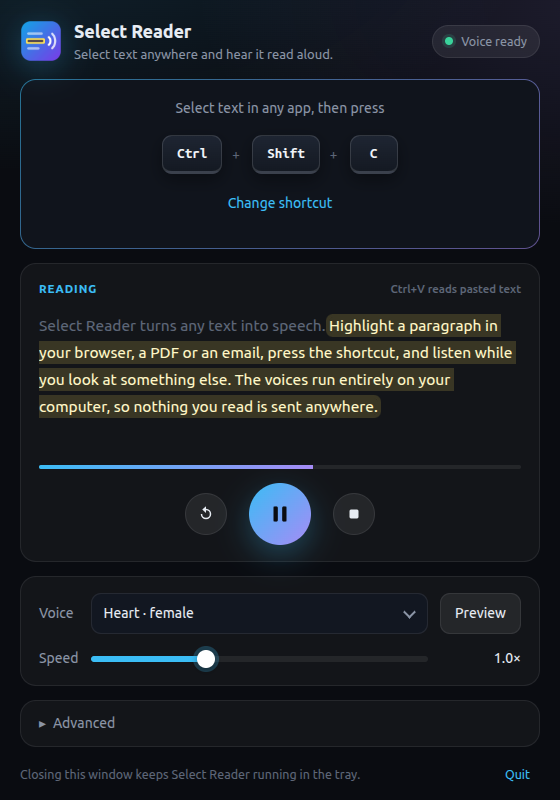

# Select Reader



Select text in any app, press a shortcut, and hear it read aloud with natural-sounding
[Kokoro](https://huggingface.co/hexgrad/Kokoro-82M) voices. Everything runs on your
computer: no account, and no internet after the first start.

Works on **Linux** and **Windows**. macOS should work too but hasn't been tested.

**Website and downloads: https://maurerkrisztian.github.io/select-reader/**

## Using it

1. Start **Select Reader**. The first start downloads the voice model (about 310 MB, once).
2. Select text in any app.
3. Press the shortcut (**Ctrl+Shift+C** by default). Press it again to stop.

In the window you can:

- **Change the shortcut**: click *Change shortcut* and press the new keys.
- Pause, stop or replay what's being read. The current sentence is highlighted.
- Pick a voice and a speed. Picking a voice plays a short preview.
- Paste text into the window (Ctrl+V) to read it.

Closing the window keeps the app running in the tray, so the shortcut keeps working.
Use **Quit** (in the window or the tray menu) to stop it.

> The shortcut is taken over while the app runs. `Ctrl+Shift+C` is also "copy" in most
> terminals and "inspect" in browsers, so pick a different shortcut if you need those.

### How it gets the selected text

Select Reader presses "copy" in the app you're using and reads what it copied, so
the selected text ends up on your clipboard too. If nothing gets copied, the text
that was on your clipboard is put back.

- **Linux:** presses Ctrl+Insert (copy, but it can't interrupt a program in a terminal)
  using `xdotool`. The `.deb` installs it; otherwise run `sudo apt install xdotool`.
  If nothing gets copied, it reads the highlighted text directly (the "primary
  selection"), which is how terminals work.
- **Windows / macOS:** presses Ctrl+C (Cmd+C).
  On macOS, allow Select Reader under *System Settings → Privacy & Security → Accessibility*.

### Linux on Wayland

Wayland desktops may block apps from reading other apps' selection or grabbing global
shortcuts. If the shortcut doesn't work, add a desktop keyboard shortcut instead
(Ubuntu: *Settings → Keyboard → Custom Shortcuts*) with the command:

```sh
select-reader --read
```

## Command line

```sh
select-reader --read          # read the selected text
select-reader --text "Hello"  # read some text
select-reader --pause         # pause / resume
select-reader --stop          # stop
```

If the app is already running, the command is passed to it. Otherwise it starts.

## Local HTTP API

For browser extensions and scripts, the app listens on `127.0.0.1:4040`:

```sh
curl "http://127.0.0.1:4040/read?text=Hello"
curl "http://127.0.0.1:4040/stop"
```

## Install

Download the installer for your system from the
[releases page](https://github.com/MaurerKrisztian/select-reader/releases), or build it
yourself (see *Development*), then:

- **Ubuntu / Debian:** `sudo apt install ./select-reader_amd64.deb`
- **Other Linux:** run `select-reader-x86_64.AppImage`
- **Windows:** run `select-reader-setup.exe`. The installer isn't signed, so
  Windows may warn about it: click *More info → Run anyway*.

### Upgrading from the Python version

If you installed the old Python version with `install.sh`, its launcher and menu entry
win over the new ones. Remove them:

```sh
rm ~/.local/bin/select-reader ~/.local/share/applications/select-reader.desktop
rm -r ~/.local/share/select-reader
```

Your settings carry over (`~/.config/select-reader/config.json`).

## Development

Needs Node.js 22 or newer.

```sh
npm install
npm start           # build and run
npm test            # unit tests
npm run dist:linux  # release/*.AppImage and *.deb
npm run dist:win    # release/*.exe (build this on Windows)
npm run dist:mac    # release/*.dmg (build this on a Mac)
```

Build each installer on its own system: npm only installs the speech engine's native
files for the system it runs on.

### Builds and releases

GitHub Actions ([.github/workflows/build.yml](.github/workflows/build.yml)) builds the
Linux and Windows installers on every push to `main` and every pull request. Download
them from the workflow run's *Artifacts*.

To publish a release, set the version in `package.json`, then push a matching tag:

```sh
git tag v0.1.0
git push origin v0.1.0
```

The workflow builds the installers and attaches them to a new GitHub release.

### Website

The website is the `site/` folder, published to GitHub Pages by
[.github/workflows/pages.yml](.github/workflows/pages.yml) whenever it changes on `main`.
One-time setup: on GitHub, open *Settings → Pages* and set *Source* to *GitHub Actions*.

Its download buttons link to the newest release, so they work once a release exists.
To preview it locally, serve the folder: `python3 -m http.server --directory site`.

### How it fits together

```
 shortcut / CLI / HTTP / tray
             │
             ▼
   main process (src/main)  ──── gets the selected text, decides what to read
             │  "read this"
             ▼
   window (src/renderer)    ──── splits text into chunks, plays audio, highlights
             │  "speak this chunk"            ▲ audio samples
             ▼                                │
   speech worker (src/worker) ── runs Kokoro in its own process
```

The first chunk is one sentence, so speech starts quickly. Each next chunk is generated
while the previous one plays.

### Files

| File | What it does |
| --- | --- |
| `src/main/main.ts` | Starts the app: window, tray, shortcut, single instance, messages from the window |
| `src/main/selection.ts` | Gets the text the user selected |
| `src/main/speech.ts` | Starts the speech worker and sends it text |
| `src/main/settings.ts` | Loads and saves `config.json` |
| `src/main/tray.ts` | Tray icon and menu |
| `src/main/cli.ts` | `--read`, `--text`, `--pause`, `--stop` |
| `src/main/http-server.ts` | The local HTTP API |
| `src/worker/kokoro-worker.ts` | Turns text into audio with Kokoro |
| `src/preload/preload.cts` | The bridge between the window and the main process |
| `src/renderer/app.ts` | The window's UI |
| `src/renderer/reader.ts` | Plays text chunk by chunk, with pause and stop |
| `src/renderer/chunks.ts` | Splits text into sentences and chunks |
| `src/renderer/keys.ts` | Turns key presses into a shortcut like `Ctrl+Shift+C` |
| `src/shared/` | Types and the voice list, used by all of the above |
| `electron-builder.yml` | Installer settings |
| `.github/workflows/build.yml` | Builds the installers on GitHub and publishes releases |
| `site/` | The website, published by `.github/workflows/pages.yml` |

Where things are stored:

| | Linux | Windows |
| --- | --- | --- |
| Settings | `~/.config/select-reader/config.json` | `%APPDATA%\select-reader\config.json` |
| Voice model | `~/.cache/select-reader/models` | `%LOCALAPPDATA%\select-reader\models` |
